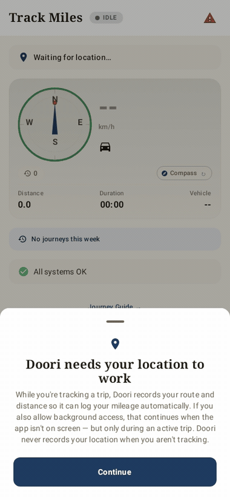
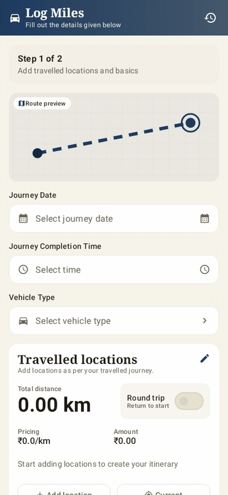

# Doori

Doori turns a recorded drive into a mileage reimbursement claim, and handles the expenses, travel requests and approvals around it. It is a Kotlin Multiplatform app for Android, iOS, Wear OS, watchOS and desktop. It runs on local data with no network.

I wrote it to put the location engineering, offline-first design and module structure I care about into one app you can run. Every company, booking, card and amount in it is mock data. The part I care about most is the location pipeline, which has to cope with GPS jitter, spikes and spoofed fixes and still produce a distance you can defend.

<!-- AUTOGEN:badges -->


<!-- /AUTOGEN:badges -->

<!-- AUTOGEN:stats -->
> **At a glance**, **52-module** clean architecture: **36 local** (13 feature · 12 core) + **16 composed** via `includeBuild(external/kmp-toolkit)`, Room schema **v50**, **425** host-rendered Roborazzi screenshots (JVM, no emulator). *Numbers auto-generated from `settings.gradle.kts` by `scripts/gen-readme.sh`.*
<!-- /AUTOGEN:stats -->



## Run it

Gradle convention plugins and the shared libraries live in two submodules under `external/`, wired in with `includeBuild`. A plain clone leaves them empty and the build stops with `Included build 'external/kmp-build-logic' does not exist`, so clone with them:

```bash
git clone --recurse-submodules https://github.com/darkpandawarrior/Doori.git
cd Doori
git submodule update --init --recursive    # if you already cloned without the flag

./gradlew assembleNoGmsDebug
adb install app/build/outputs/apk/noGms/debug/app-noGms-debug.apk
```

You need JDK 25 (`ci.yml` pins it, and the convention plugins compile at Java 25) and an Android SDK. `minSdk` is 30 and the plugins use `compileSdk` 37. For the iOS and watchOS targets you also need a Mac with Xcode. In the noGms build only the optional backend and the cloud assistant key path touch a network. To check the offline claim, switch on airplane mode, track a trip, kill the app, relaunch, and confirm the trip is still there.

The same build as a gate, which is what CI runs:

```bash
./gradlew assembleNoGmsDebug && ./gradlew testNoGmsDebugUnitTest
```

Only the `noGms` flavor has unit tests; the `gms` flavor crashes Robolectric.

More targets:

```bash
./gradlew assembleGmsDebug                          # Google Maps, Firebase, Play services
./gradlew assembleNoGmsRelease                      # the FOSS release build
./gradlew recordRoborazziNoGmsDebug                 # re-record screenshot baselines in docs/screenshots/
./gradlew ktlintCheck detekt                        # style and static analysis
./gradlew :app:koverXmlReportNoGmsDebugCoverage     # coverage, the task name quality.yml uses
./gradlew :desktopApp:assemble                      # Compose Desktop dashboard
./gradlew :wear:assembleNoGmsDebug                  # Wear OS
./gradlew :shared:compileKotlinIosSimulatorArm64    # iOS compile check; run it from iosApp/ in Xcode
./gradlew :server:run                               # Ktor backend on :8080 with in-memory H2
```

The backend is optional. `NetworkBackendFlags.useRealBackend` is `false`, so the app runs on local data until you flip it and point `BaseUrlProvider` at the server (`http://10.0.2.2:8080` from an emulator). To run it against Postgres, build the distribution first because the image packages it rather than compiling:

```bash
./gradlew :server:installDist
JWT_SECRET=dev-secret docker compose up --build
```

`JWT_SECRET` is required by design and compose aborts without it.

## The location pipeline

This is where most of the effort went.

- **Jitter.** Drift while you are stationary is filtered out and the anchor point is kept.
- **Spikes.** An implied-speed check flags fixes that teleport instead of silently dropping them.
- **Four buckets.** Each track stores `original`, `cleaned`, `abnormal` and `mock` distances, so you can see what was removed and why.
- **Mock locations** are flagged and counted in their own bucket.
- **Sampling** adapts to device tier, and the spike thresholds come from one config object, not numbers scattered through the code.
- **Recompute.** Distances can be rebuilt from the stored points, so a fix to the maths re-derives old trips instead of leaving them on the old numbers.

`SIMULATE_LOCATION = true` (in `LocationTrackingService`) feeds a simulated drive through the same pipeline, so tracking works on an emulator with no GPS.

## What is in the app

Tracking on a foreground service with geofenced check-in. Manual trip logging and a two-step expense wizard whose submissions go through a durable Room outbox that survives a kill. Approvals with policy-violation badges and delegation, payables, travel requests, cards, advances, events and payments. A plugin registry that turns features on and off per persona, so one account can reshape the app. A dynamic form engine, on-device document extraction for receipts, and an expense assistant that streams replies through `LlmGateway`: ML Kit GenAI on Android, Apple Foundation Models on iOS, and a bring-your-own-key cloud fallback (Anthropic, OpenAI or Gemini) stored through `SecureKeyStore`. The default theme is Paper, picked from a five-way comparison on 2026-08-10 (`docs/DECISIONS.md`).

Beyond the phone: a Wear OS app with a tile, a SwiftUI watchOS app over a headless `:sharedWatch` framework, iOS widgets and a Live Activity, an Android Glance widget, App Intents and AppFunctions, a Compose Desktop dashboard and a wasmJs preview. [Phone journeys](docs/gifs) and [the screenshot catalogue](docs/screenshots) are all rendered from mock data on the JVM.



## How it is put together

Feature modules never depend on one another. They meet in `:app`, wired with Koin. Each screen has one immutable state exposed as a `StateFlow` and rendered through a shared `ScreenState` that covers loading, empty, error and content. Room and DataStore are the source of truth; reads come from Room and writes queue.

```
app/ desktopApp/ wear/ widget/ iosApp/ sharedWatch/   entry points per platform
feature/   tracking logging media profile approvals payables travel agent
           cards advances payments events whatsnew
core/      ui common data network platform security ai forms media
           maps maps-maplibre maps-krossmap
contract/  DTOs and PolicyRateEngine shared by app and server
server/    Ktor + Exposed backend, opt-in
stub/      deterministic mock data behind every repository
external/  kmp-build-logic, kmp-toolkit (submodules)
```

[kmp-toolkit](https://github.com/darkpandawarrior/kmp-toolkit) supplies `mvi-core`, `result`, `common`, `location`, `offline-outbox`, `security`, `network`, `ai` and other modules; this repo takes 16 of them through dependency substitution rather than copying them. [kmp-build-logic](https://github.com/darkpandawarrior/kmp-build-logic) holds the convention plugins. The server and client share `:contract`, including the `PolicyRateEngine` that computes reimbursement on both sides, and the server dedups location events by `opId` against a unique index.

The `maps` flavor dimension makes two builds. `gms` uses Google Maps and Firebase. `noGms` uses MapLibre with offline MBTiles and no Firebase, and a Gradle check fails the build if a Play Services, ML Kit, Firebase or Google Maps artifact reaches its release classpath. A `dependencyGuard` baseline pins the rest. `docs/OWNER_ACTIONS.md` records that the baseline now holds none, and that the F-Droid listing still waits on signing secrets. Design rules are in [DESIGN.md](DESIGN.md), settled choices in [docs/DECISIONS.md](docs/DECISIONS.md), and every generated artefact in [docs/ARTEFACT_INDEX.md](docs/ARTEFACT_INDEX.md). The code still says `Mileway` in package and class names; that was the project's earlier name.

## What is verified, and what is not

Counted today outside `external/`: **3,315 `@Test` methods in 485 files** (`grep -rho '@Test' --include='*.kt' --exclude-dir=external .`) and 425 screenshot PNGs.

- `quality.yml` runs the unit tests, ktlint, detekt, Kover and `dependencyGuard`. `ci.yml` builds, runs the server tests and the instrumented suite on a Gradle Managed Device, and compiles the wasm preview. `ios.yml` compiles the iOS frameworks.
- No workflow runs the `xcodebuild` builds for the watchOS and widget schemes or the watchOS screenshot tests. Those are run locally, not by a workflow.
- There is no `iosTest` source set. Kotlin/Native rejects some backtick test names the shared suites use, so iOS-only logic is kept in `commonMain` to be testable.
- The on-device LLM tiers (Gemini Nano and Apple Foundation Models) are compile-checked and unit-tested against fakes. I have no eligible hardware, so the cloud key path is the only one run end to end.
- The iOS app is a subset: it hosts `MilewayApp()` with Home, Track, Spends, Travel and More. The full Compose navigation host is Android-only, and a few detail screens are not wired on iOS.
- Store workflows (Play, F-Droid, Amazon, Huawei, Samsung, Indus, Aptoide) exist and do nothing until their secrets are set. Uptodown has no submission API.

Related: [PaymentsLab-KMP](https://github.com/darkpandawarrior/PaymentsLab-KMP), [Gaddi](https://github.com/darkpandawarrior/Gaddi), and the [case study](https://cv-siddharth.vercel.app/project/doori). A project page is built from `site/` by `pages.yml`.
